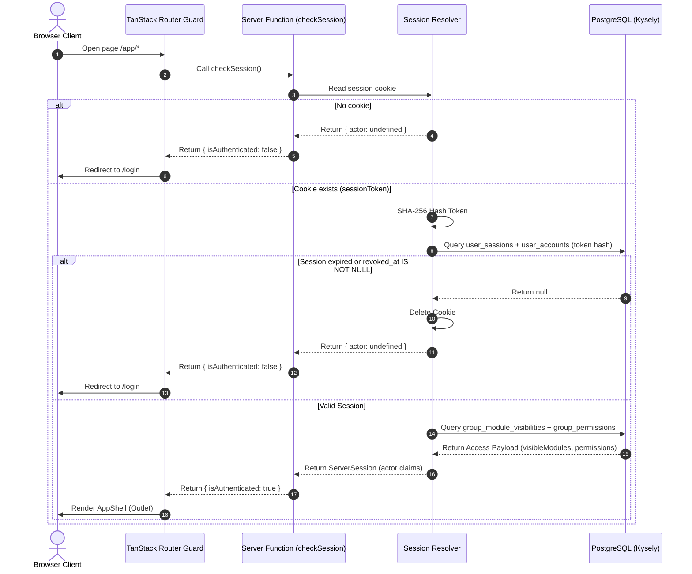
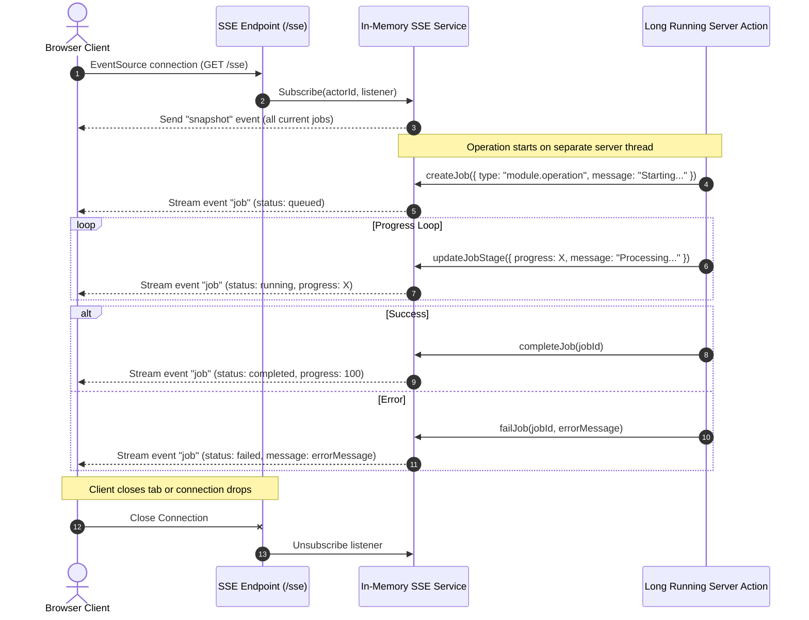

# Flow Diagrams — Bare Bone

This document contains visual representations of core architectural flows using Mermaid diagrams.

---

## 1. Session Resolution & Auth Guard Flow

How the server determines actor identity and access rights on every request.



---

## 2. Generic Data Processing Flow (Two-Step Commit)

A generic pattern for handling multi-step operations with preview and commit phases, ensuring data safety.

```mermaid
graph TD
    A[Client: Submit Data] :::accent0 -->|1. Preview| B[SSE Job: Created] :::accent1
    B -->|2. Process input| C[Parse & Validate Data] :::accent3
    C -->|3. Save preview| D[In-Memory Preview Cache] :::accent4
    D -->|4. Return previewId| E[Client: Render Preview] :::accent0
    
    E -->|5. User clicks Commit| F[SSE Job: Created] :::accent1
    F -->|6. Retrieve Cache| G[Read Preview Cache] :::accent4
    
    G -->|7. External Backup| H{Backup Successful?} :::accent2
    H -->|Failed| I[Throw AppError / DB untouched / Cache Recoverable] :::accent7
    H -->|Success| J[Insert to PostgreSQL - Kysely Transaction] :::accent1
    
    J -->|8. DB success| K[Consume / Delete Preview Cache] :::accent3
    K -->|9. SSE Job: Completed| L[Client: Redirect to List] :::accent0

    classDef default fill:#f9f9f9,stroke:#333,stroke-width:1px;
```

---

## 3. SSE Broadcast Flow (In-Memory Job System)

Real-time broadcasting of progress updates without Redis.



---

## 4. Server Function Boundary Flow

How a request flows from the React component through layers to the database.

```mermaid
graph TD
    A[React Component] :::accent0 -->|1. Call server fn| B[query.ts / server-action.ts] :::accent1
    B -->|2. createServerFn handler| C{withSystemLog?} :::accent2
    C -->|Yes - Mutations| D[withSystemLog wrapper] :::accent4
    C -->|No - Read-only| E[createServerOnlyFn] :::accent3
    
    D -->|3. Delegate| E
    E -->|4. Dynamic import| F[Backend Service Layer] :::accent1
    
    F -->|5. Auth check| G[assertModuleVisible / assertPermission] :::accent3
    G -->|6. Business logic| H[Service functions] :::accent4
    H -->|7. Data access| I[Repository Layer] :::accent0
    I -->|8. Kysely query| J[PostgreSQL] :::accent7

    classDef default fill:#f9f9f9,stroke:#333,stroke-width:1px;
```

---

## 5. Module Registration Flow

How a new module is registered across the system.

```mermaid
graph LR
    A[router/module-config.ts] :::accent0 -->|Define module config| B[Sidebar Navigation] :::accent1
    C[lib/shared/permissions.ts] :::accent3 -->|Define permission contract| D[RBAC Enforcement] :::accent4
    E[Seed Scripts] :::accent1 -->|Populate DB| F[PostgreSQL] :::accent7
    
    B -->|Filter by access| G[UI Rendering] :::accent0
    D -->|Check at runtime| G
    
    classDef default fill:#f9f9f9,stroke:#333,stroke-width:1px;
```
